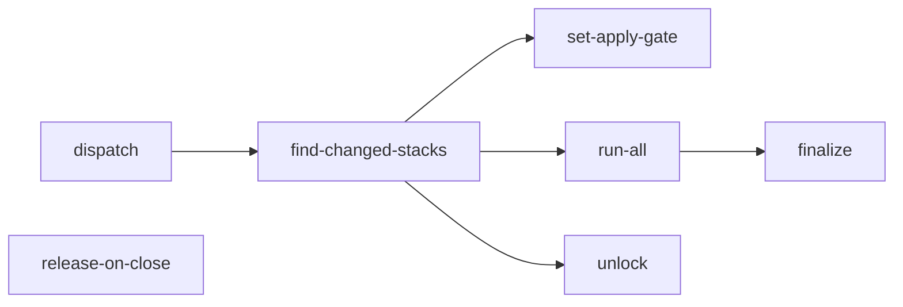

# Terragrunt Engine

Terragrunt Engine (`.github/workflows/terragrunt-engine.yml`) is CZI’s reusable GitHub Actions workflow for running Terraform through Terragrunt.
Infrastructure repositories call it to plan or apply changes.
The engine selects the affected stacks, configures credentials, runs the requested operation, and reports the results.
It also handles PR commands such as `@terragrunt-bot apply-and-merge`, which applies changes before attempting to merge the PR.

## What it does

### Automatic plans on pull requests

Infrastructure repositories enable automatic planning by adding a caller workflow under `.github/workflows/`.
That workflow listens for GitHub pull request events and invokes Terragrunt Engine with `action: plan -lock=false`.

For example, `shared-infra` runs this workflow when a pull request is opened, updated with new commits, or reopened.
The engine identifies the affected stacks and runs Terragrunt plans for them.
If no stacks are affected, it skips running Terragrunt.

The caller workflow defines the event triggers, while Terragrunt Engine exposes `workflow_call` so other workflows can invoke it.

### Applying Terraform changes before merging a PR

When someone comments `@terragrunt-bot apply-and-merge` on a PR, the repository’s caller workflow invokes Terragrunt Engine with `action: apply`.
The engine checks permissions and PR readiness, applies the affected stacks, and attempts to merge the PR if all applies succeed.

## Jobs

| Job | Runs when | Purpose |
| --- | --- | --- |
| `dispatch` | PR comment | TODO |
| `find-changed-stacks` | | TODO |
| `set-apply-gate` | | TODO |
| `run-all` | | TODO |
| `unlock` | | TODO |
| `finalize` | | TODO |
| `release-on-close` | PR closed | TODO |

## PR lifecycle

!!! todo
    Describe the sequence: open PR, plan, review, `apply-and-merge`, finalize, auto-merge.

## Composite actions it uses

!!! todo
    List each `terragrunt-*` action under `.github/actions/` and what it is responsible for.
