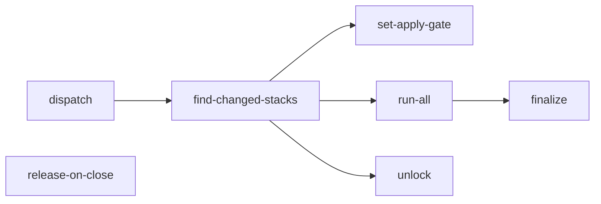

# Terragrunt Engine

A reusable workflow (`.github/workflows/terragrunt-engine.yml`) that runs
Terragrunt plans on pull requests and applies them before merge, driven by
`@terragrunt-bot` PR comments.

## What it does

!!! todo
    Summarize the plan-on-PR and apply-before-merge lifecycle in a few sentences.

## Jobs

| Job | Runs when | Purpose |
| --- | --- | --- |
| `dispatch` | PR comment | TODO |
| `find-changed-stacks` | | TODO |
| `set-apply-gate` | | TODO |
| `run-all` | | TODO |
| `unlock` | | TODO |
| `finalize` | | TODO |
| `release-on-close` | PR closed | TODO |

## PR lifecycle

!!! todo
    Describe the sequence: open PR, plan, review, `apply-and-merge`, finalize, auto-merge.

## Composite actions it uses

!!! todo
    List each `terragrunt-*` action under `.github/actions/` and what it is responsible for.
