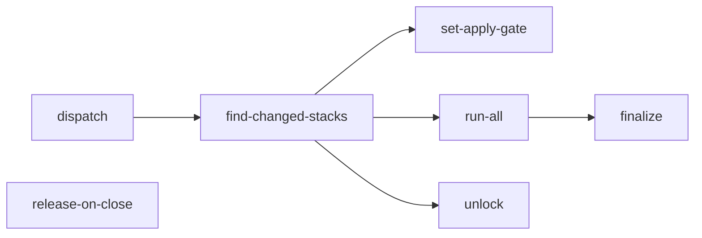

# Terragrunt Engine

Terragrunt Engine (`.github/workflows/terragrunt-engine.yml`) is CZI’s reusable GitHub Actions workflow for running Terraform through Terragrunt.
Infrastructure repositories call it to plan or apply changes.
The engine selects the affected stacks, configures credentials, runs the requested operation, and reports the results.
It also handles PR commands such as `@terragrunt-bot apply-and-merge`, which applies changes before attempting to merge the PR.

## What it does

!!! todo
    Summarize the plan-on-PR and apply-before-merge lifecycle in a few sentences.

## Jobs

| Job | Runs when | Purpose |
| --- | --- | --- |
| `dispatch` | PR comment | TODO |
| `find-changed-stacks` | | TODO |
| `set-apply-gate` | | TODO |
| `run-all` | | TODO |
| `unlock` | | TODO |
| `finalize` | | TODO |
| `release-on-close` | PR closed | TODO |

## PR lifecycle

!!! todo
    Describe the sequence: open PR, plan, review, `apply-and-merge`, finalize, auto-merge.

## Composite actions it uses

!!! todo
    List each `terragrunt-*` action under `.github/actions/` and what it is responsible for.
