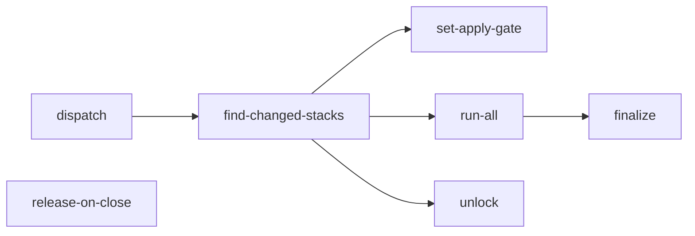

# Terragrunt Engine

Terragrunt Engine (`.github/workflows/terragrunt-engine.yml`) is CZI’s reusable GitHub Actions workflow for running Terraform through Terragrunt.
Infrastructure repositories call it to plan or apply changes.
The engine selects the affected stacks, configures credentials, runs the requested operation, and reports the results.
It also handles PR commands such as `@terragrunt-bot apply-and-merge`, which applies changes before attempting to merge the PR.

Terragrunt Engine provides a lightweight alternative to tools such as [Atlantis](https://www.runatlantis.io/) for running Terraform through pull requests.
Using our existing GitHub Actions setup means we do not need to deploy, operate, or maintain a separate Atlantis server.

## What it does

### Automatic plans on pull requests

Infrastructure repositories enable automatic planning by adding a caller workflow under `.github/workflows/`.
That workflow listens for GitHub pull request events and invokes Terragrunt Engine with `action: plan -lock=false`.

For example, `shared-infra` runs this workflow when a pull request is opened, updated with new commits, or reopened.
The engine identifies the affected stacks and runs Terragrunt plans for them.
If no stacks are affected, it skips running Terragrunt.

The caller workflow defines the event triggers, while Terragrunt Engine exposes `workflow_call` so other workflows can invoke it.

### Applying Terraform changes before merging a PR

When someone comments `@terragrunt-bot apply-and-merge` on a PR, the repository’s caller workflow invokes Terragrunt Engine with `action: apply`.
The engine checks permissions and PR readiness, applies the affected stacks, and attempts to merge the PR if all applies succeed.

## Jobs

The caller workflow determines which GitHub events invoke the engine.
This table describes the usual flow, with a few exceptions; see the job conditions in [terragrunt-engine.yml](https://github.com/chanzuckerberg/github-actions/blob/main/.github/workflows/terragrunt-engine.yml) for the full details.

| Job | Runs when | Purpose |
| --- | --- | --- |
| `dispatch` | Someone comments a bot command on a PR. | Parses bot commands, performs the required permission and PR checks, and routes accepted commands to the appropriate jobs. |
| `find-changed-stacks` | At the start of a plan, apply, or unlock run. | Identifies the stacks affected by the changes. |
| `set-apply-gate` | After stack discovery, if the caller enables the apply gate. | Sets the PR’s apply status to pending when stacks change, or success when none change, and posts instructions when an apply is needed. |
| `run-all` | When there are stacks to plan or apply. | Runs the requested Terragrunt command (`plan` or `apply`) on the stacks identified by `find-changed-stacks`. |
| `unlock` | Someone comments `@terragrunt-bot unlock` on a PR. | Force-releases DynamoDB state locks and stack ownership claims for affected stacks. |
| `finalize` | After an apply-and-merge attempt finishes. | Reports apply results and attempts to merge the PR if all applies succeed. |
| `release-on-close` | A PR is merged or closed. | Releases the PR’s stack ownership claims, returning control to `main`. |

!!! warning "State locking"
    [DynamoDB-based state locking](https://developer.hashicorp.com/terraform/language/backend/s3#state-locking) is deprecated in favor of native S3 locking (`use_lockfile = true`, Terraform 1.10+), but this engine’s lock cleanup currently supports DynamoDB state locks only.

## PR lifecycle

A typical (happy path) PR follows this process:

1. Open a PR.
2. The engine automatically identifies the affected stacks using `find-changed-stacks` and runs a `plan` against each of them.
3. Review the plan and get the required approvals for your PR.
4. Comment `@terragrunt-bot apply-and-merge`.
   The engine checks that you have write access, that the PR meets its review requirements, and that it is ready to merge.
5. The engine applies the Terraform changes.
6. If all applies succeed, the engine attempts to merge the PR into the target branch (usually `main`).
   If an apply fails, the engine reports the failure in a PR comment.
7. When the PR is merged or closed, the engine releases any remaining stack ownership claims.

## Learn more

- [Getting started](getting-started.md) covers repository prerequisites and the caller workflows, including scheduled and manual runs.
- [Bot commands](bot-commands.md) explains command options and the checks performed before applying.
- [Authentication and state](authentication-and-state.md) traces GitHub and AWS credentials, state storage, and locking.
- [Stack authority](stack-authority.md) explains how the engine coordinates competing PRs.
- [Inputs reference](inputs.md) lists configuration values and secret conventions.
- [Troubleshooting](troubleshooting.md) describes common failures and how to investigate them.
